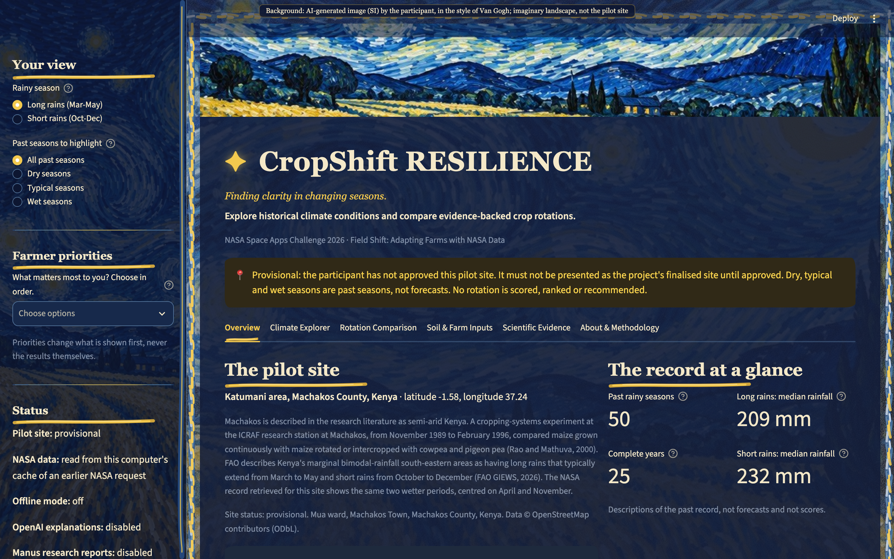
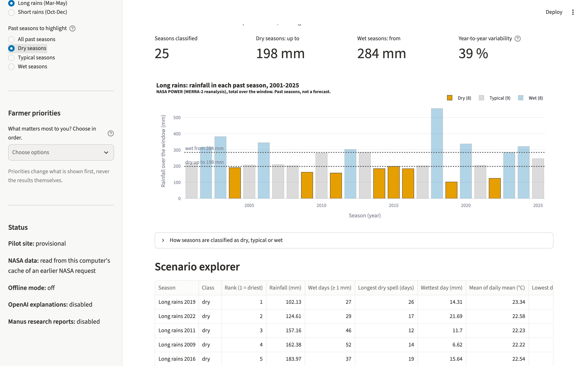
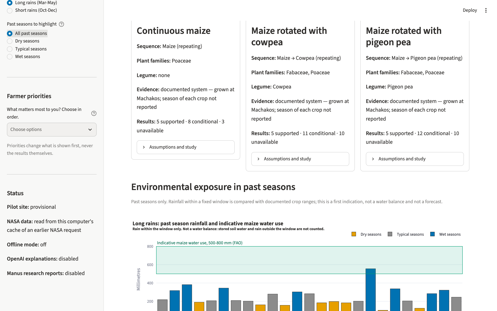
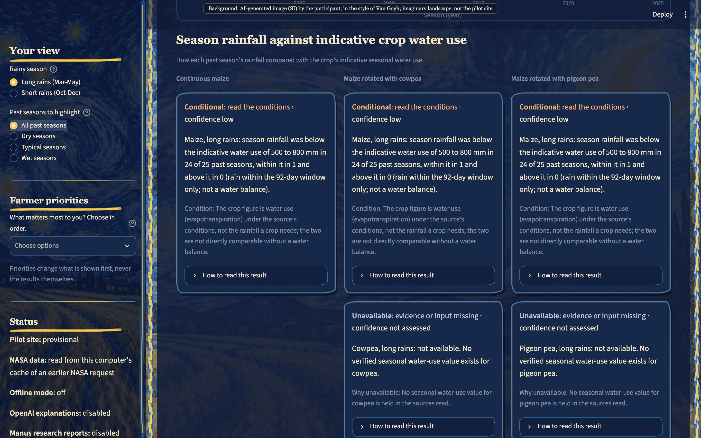
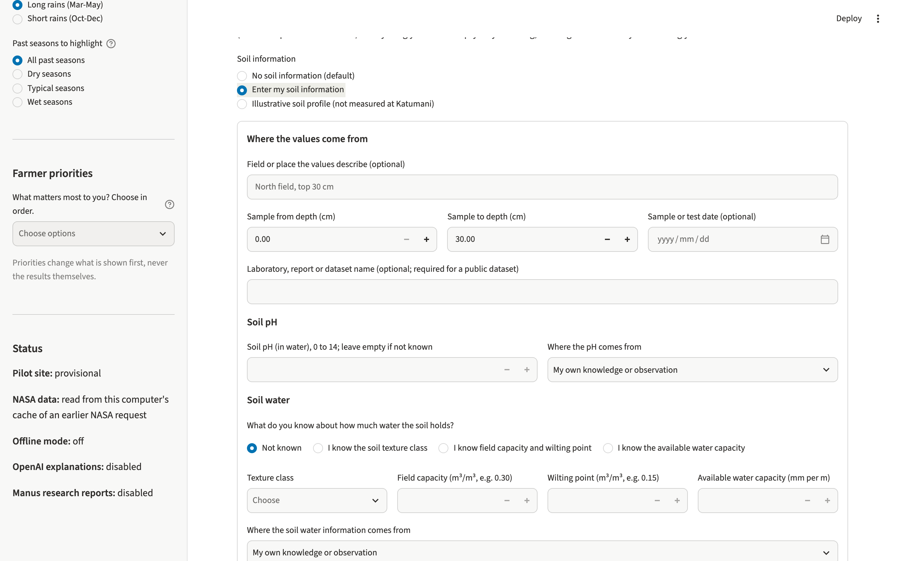
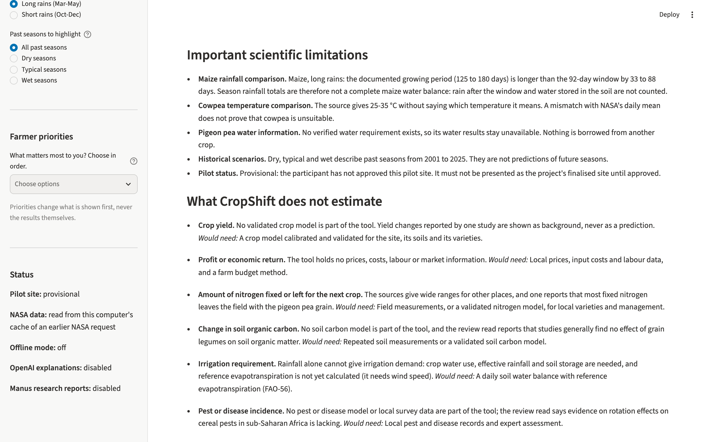

# CropShift RESILIENCE

**Compare crop rotations against 25 years of NASA climate history, with the
evidence, the gaps and the uncertainty in plain view.**

An entry to the **NASA Space Apps Challenge 2026**, challenge
[Field Shift: Adapting Farms with NASA Data](https://www.spaceappschallenge.org/2026/challenges/adapting-farms-with-nasa-data/),
Singapore Local Event. Built during the hackathon by Isaac Lee Kumar, a solo
participant competing as team WindShift.

**Demo:** [seven-slide deck (PDF)](docs/presentation/CropShift_RESILIENCE_demo.pdf)



## For judges: CropShift in two minutes

**1. What is CropShift?**
A small web app that lets a farmer, or an extension officer working with
one, set three crop rotations side by side against what the weather actually
did in 50 past rainy seasons at one pilot area in Kenya. It shows what the
evidence says, what it does not say, and how sure each result is.

**2. What agricultural problem does it address?**
Rainfall at the pilot area swings widely: long-rains rainfall ranged from
102 mm to 556 mm between 2001 and 2025. Farmers choosing a rotation have to
weigh rainfall they cannot predict, and the crop evidence they would need is
scattered across manuals, datasheets and papers, often with conditions
attached.

**3. How does it use NASA data?**
It uses 25 years (2001 to 2025, 9,131 days) of daily
[NASA POWER](https://power.larc.nasa.gov/) data: rainfall, temperature,
humidity and sunshine. The data is stored exactly as NASA returned it,
fingerprinted, and turned into season totals, wet days, dry spells and
dry/typical/wet thirds of the record.

**4. What can a user actually do?**
* Explore every past long-rains and short-rains season, day by day.
* Compare continuous maize, maize rotated with cowpea and maize rotated with
  pigeon pea, three systems grown in a published experiment at Machakos.
* Enter their own soil information (pH, texture, water-holding values), each
  labelled by where it came from.
* Choose their priorities, which change what is shown first, never the results.
* Read where every number came from, and download the comparison.

**5. What makes it distinctive?**
It is not a crop-recommendation chatbot. It joins real NASA observations,
historical season comparisons, published rotation evidence, optional soil
inputs and farmer priorities, and it keeps the provenance of every value. When
evidence is missing it says "not available" instead of estimating. It never
scores or ranks a rotation. Its core is deterministic and works offline.

**6. How can judges run it?** See [Run it](#run-it) below: three commands, about
a minute, no account or key needed.

**7. What does it not claim to do?**
It does not predict yield, profit, nitrogen or soil-health effects. It does not
forecast weather, does not name a best rotation, and has not been reviewed by
an agronomist or tested with farmers. The pilot site is provisional. Details:
[What CropShift does not claim](#what-cropshift-does-not-claim).

**8. How was AI used?**
The code, tests and documentation were written with an AI coding assistant
(Claude Code, by Anthropic) under the participant's direction. The running app
uses no AI: its engine is ordinary deterministic Python, and its optional
OpenAI and Manus integrations are switched off and not built. See
[AI-assisted development](#ai-assisted-development).

## Screenshots

All are real screenshots of the running app, taken on 15 November 2026.

| | |
| --- | --- |
|  |  |
| **Climate Explorer**: every past long-rains season, dry seasons highlighted | **Rotation Comparison**: three documented rotations, side by side |
|  |  |
| **Results**: maize rainfall comparison; cowpea and pigeon pea marked unavailable | **Soil & Farm Inputs**: every value labelled by its source |
|  | |
| **Scientific Evidence**: limitations and what is not estimated | |

## Run it

Requires Python 3.11 or newer (tested with Python 3.12.13). Run every command
from the repository root, so that Python finds the `src` package.

```bash
python3 -m venv .venv
.venv/bin/pip install -r requirements-lock.txt
.venv/bin/python -m streamlit run app.py --server.address localhost
```

Open http://localhost:8501. `--server.address localhost` keeps the app
visible only on your own computer.

`requirements-lock.txt` pins the exact 46 package versions that were tested.
`requirements.txt` gives the allowed ranges instead. With
[uv](https://docs.astral.sh/uv/):

```bash
uv venv --python 3.12 .venv
uv pip install --python .venv/bin/python -r requirements-lock.txt
.venv/bin/python -m streamlit run app.py --server.address localhost
```

On first start the app requests the pilot dataset from NASA (about a second)
and caches it. Without a connection it falls back to the copy bundled in
`data/demo/` and says so. To run with no network at all:

```bash
OFFLINE_DEMO_MODE=true .venv/bin/python -m streamlit run app.py --server.address localhost
```

On 15 November 2026 a fresh clone was installed from the lock file, passed all
905 routine tests, and the app started and answered its health check.

### A two-minute walkthrough

1. **Overview**: the pilot site, the record at a glance and its provisional status.
2. **Climate Explorer**: choose *Dry seasons* in the sidebar; look at the
   driest long-rains seasons day by day.
3. **Rotation Comparison**: read the maize rainfall cards, then the cowpea and
   pigeon pea cards that say *Unavailable* and why.
4. **Soil & Farm Inputs**: choose *Illustrative soil profile* to unlock the
   soil results, clearly labelled as not measured at the site.
5. **Sidebar priorities**: choose *Water conservation*; the order changes, the results don't.
6. **Scientific Evidence**: the limitations and *What CropShift does not estimate*.

The full script and every control are in
[docs/a5_application_guide.md](docs/a5_application_guide.md).

## How it works

```
NASA POWER daily data ─┐
Cited crop evidence ───┼─► evidence gate ─► deterministic comparison ─► side-by-side results
Optional soil inputs ──┤   (audited values     (3 rotations, 11 indicators,   with six-part
Farmer priorities ─────┘    only)               14 constraints, 50 seasons)    explanations
```

* **NASA data layer** (`src/nasa_client.py`, `nasa_cache.py`,
  `data_validation.py`): requests with timeouts and bounded retries, a verified
  cache, three-level validation and a provenance record for every dataset.
* **Knowledge base** (`data/knowledge/`): six crops, thirteen sources and 205
  cited claims, each with its source, location in the source and confidence.
* **Evidence audit and gate** (`src/evidence_audit.py`): every source was
  re-checked; a value enters a calculation only if the audit supports it, and
  conditional values carry their conditions.
* **Scenarios** (`src/scenario_engine.py`): 25 long-rains (March to May) and 25
  short-rains (October to December) seasons, split into dry, typical and wet
  thirds of the record.
* **Comparison engine** (`src/comparison_engine.py`, `uncertainty.py`): 11
  indicators and 14 constraints for each rotation, with a confidence level and
  a six-part explanation for each result. No overall score exists.
* **Interface** (`app.py`, `src/visualizations.py`): Streamlit and Plotly, six
  tabs, colour-blind-safe charts, Markdown and JSON downloads.

Architecture: [docs/architecture.md](docs/architecture.md).

## NASA data methodology

* **Source:** NASA POWER Daily API v2.10.3, community AG, time standard UTC.
* **Parameters:** `PRECTOTCORR` (rainfall), `T2M`, `T2M_MAX`, `T2M_MIN`
  (temperature), `RH2M` (humidity), `ALLSKY_SFC_SW_DWN` (sunshine).
* **Underlying products:** MERRA-2 reanalysis (weather) and CERES SYN1deg
  (sunshine), as distributed by NASA POWER.
* **Location:** latitude -1.58, longitude 37.24, the Katumani area of Machakos
  County, Kenya (provisional pilot site).
* **Period:** 1 January 2001 to 31 December 2025, 9,131 days, 100 % complete.
* **Integrity:** NASA's response is stored unmodified with a SHA-256
  fingerprint that is checked on every read; a tampered copy is refused.
* **Season statistics:** totals over fixed windows, wet days (at least 1 mm),
  longest dry spell, wettest day and frost days, using the ETCCDI index
  definitions.

Details: [docs/data_layer.md](docs/data_layer.md),
[docs/data_sources.md](docs/data_sources.md) and
[docs/historical_scenarios.md](docs/historical_scenarios.md).

## Agronomic knowledge methodology

Every crop value was read from a cited source: two FAO irrigation manuals
(FAO-56 and FAO Training Manual 3), six Feedipedia datasheets, a seven-year
cropping-systems experiment at Machakos (Rao and Mathuva, 2000), a review of
legume rotations in sub-Saharan Africa (Franke et al., 2018), FAO Conservation
Agriculture pages and the FAO GIEWS country brief for Kenya. Where the sources
are silent, the value is recorded as "not established" and never filled. All
thirteen sources were audited in phase A4.

Details: [docs/agronomic_knowledge.md](docs/agronomic_knowledge.md),
[docs/scientific_evidence_audit.md](docs/scientific_evidence_audit.md) and
[docs/rotation_comparison_methodology.md](docs/rotation_comparison_methodology.md).

## What CropShift does not claim

* **No forecasts.** Dry, typical and wet are thirds of the 2001 to 2025 record,
  not predictions.
* **No yield, profit, nitrogen or soil-carbon estimates**, no irrigation need,
  no pest or erosion assessment, and no overall resilience score.
* **No best rotation.** Results are shown side by side; nothing is ranked or
  recommended.
* **Not a water balance.** The rainfall comparison counts only rain inside a
  92-day window. It leaves out evaporation, runoff and stored soil water.
* **Global crop figures.** Maize's 500 to 800 mm water use is an FAO figure for
  the whole growing period and may not match local varieties.
* **Unknown planting calendar.** The windows are fixed analysis periods, not
  sowing dates, and the study does not say which crop was grown in which season.
* **Undefined temperature measures.** The sources do not say whether their
  temperature ranges mean the daily mean, maximum or minimum, so the
  temperature results are not evidence of suitability.
* **Area, not field.** NASA's weather values average over grid cells about
  55 km by 70 km. They come from a reanalysis and have not been compared with a
  local station.
* **Provisional site.** The Katumani pilot area has not been approved as final.
* **No external review.** No agronomist has reviewed the knowledge base and no
  farmer has used the tool. The A8 validation was internal, by the same
  AI-assisted process that built it.
* English only.

The full register of safe, qualified and forbidden claims is in
[docs/a9_claims_register.md](docs/a9_claims_register.md).

## Tests

```bash
.venv/bin/python -m pytest
```

905 tests run without any network access: HTTP is simulated and a guard fails
any real request. They cover the data contracts, NASA client, cache,
validation, knowledge base, evidence gate, soil inputs, scenarios, every
comparison indicator, the absence of any score or fabricated outcome, the app's
screens and twelve-step journey, and wording that would overclaim. Thirty-one
of them recalculate the key numbers straight from the raw NASA file without the
project's own code.

One further test contacts NASA and is skipped unless asked for:

```bash
.venv/bin/python -m pytest tests/test_live_power.py --run-live
```

## Reproducing the results

1. Install from `requirements-lock.txt` as above.
2. `OFFLINE_DEMO_MODE=true .venv/bin/python -c "from src.comparison_engine import run_pilot_comparison; print(run_pilot_comparison().model_dump_json(indent=2))"`
   prints the full comparison from the bundled NASA response.
3. `.venv/bin/python -m src.data_service pilot` requests the same dataset from
   NASA again and reports its provenance and completeness.
4. `.venv/bin/python -m pytest tests/test_independent_verification.py`
   recalculates season totals, temperatures, thirds and soil equations by a
   separate path.

## Configuration

Every setting is optional and the app starts with safe defaults and no `.env`
file. To change one, copy `.env.example` to `.env` (ignored by Git) and edit
the copy.

| Setting | Default | Meaning |
| --- | --- | --- |
| `OFFLINE_DEMO_MODE` | `false` | Use stored NASA data only; make no network requests |
| `ENABLE_OPENAI` | `false` | Optional OpenAI explanations (A6, deferred, not built) |
| `ENABLE_MANUS` | `false` | Optional Manus reports (A7, deferred, not built) |
| `NASA_POWER_BASE_URL` | NASA POWER daily point endpoint | Must be `https` |
| `NASA_REQUEST_TIMEOUT` | `30` | Seconds to wait for a NASA response |
| `NASA_MAX_RETRIES` | `3` | Extra attempts after a rate limit, timeout or server error |
| `NASA_CACHE_DIRECTORY` | `data/cache` | Cache folder for NASA responses |
| `NASA_CACHE_TTL_HOURS` | `720` | Hours before a cached response is requested again |
| `NASA_DEMO_DIRECTORY` | `data/demo` | Bundled real NASA responses for offline use |
| `NASA_MIN_COMPLETENESS_PERCENT` | `90` | Minimum completeness for a dataset to be accepted |
| `LOG_LEVEL` | `INFO` | Logging level |

NASA POWER needs no account or key. No paid service is used.

## Repository layout

```
app.py                  Streamlit application
requirements.txt        Allowed dependency ranges
requirements-lock.txt   Exact tested versions (46 packages)
.env.example            Documented settings (no secrets)
src/                    NASA data layer, knowledge base, evidence gate,
                        scenarios, comparison engine, charts, exports
                        (persistence, openai_service and manus_service are
                        empty placeholders: deferred, switched off)
data/knowledge/         Cited crop, soil and rotation knowledge (JSON)
data/demo/              NASA's response for the pilot site, unmodified
tests/                  905 automated tests and a recorded NASA response
docs/                   Methodology, validation reports, provenance
docs/screenshots/       Real screenshots of the app
```

## Documentation

| Document | Contents |
| --- | --- |
| [docs/a9_claims_register.md](docs/a9_claims_register.md) | What may be claimed, what must be qualified, what must not be claimed |
| [docs/a9_submission_text.md](docs/a9_submission_text.md) | Text for the Space Apps project page |
| [docs/a9_release_report.md](docs/a9_release_report.md) | A9 release, licensing and publication audit, submission checklist |
| [docs/a9_publication_report.md](docs/a9_publication_report.md) | Final publication: licence, commit identity, privacy audit, public access checks |
| [docs/a8_validation_report.md](docs/a8_validation_report.md) | Internal validation by separate recalculation: science, NASA data, browser walkthrough, security, accessibility (not an external review) |
| [docs/a5_application_guide.md](docs/a5_application_guide.md) | Using the app; demonstration script; known issues |
| [docs/rotation_comparison_methodology.md](docs/rotation_comparison_methodology.md) | Indicators, constraints, priorities, tradeoffs and the pilot results |
| [docs/historical_scenarios.md](docs/historical_scenarios.md) | Dry, typical and wet past seasons, with every season listed |
| [docs/scientific_evidence_audit.md](docs/scientific_evidence_audit.md) | Audit of all thirteen sources |
| [docs/agronomic_knowledge.md](docs/agronomic_knowledge.md) | Crops, requirements, rotation relationships, constraints |
| [docs/evidence_registry.md](docs/evidence_registry.md) | Every agronomic source with full citation |
| [docs/soil_input_mapping.md](docs/soil_input_mapping.md) | Soil inputs, validation and provenance |
| [docs/pilot_configuration.md](docs/pilot_configuration.md) | The provisional pilot site, season windows and strategies |
| [docs/uncertainty.md](docs/uncertainty.md) | Confidence rule and explanations |
| [docs/data_layer.md](docs/data_layer.md) | NASA data layer: commands, data dictionary, quality rules, offline mode |
| [docs/data_sources.md](docs/data_sources.md) | What was verified about NASA POWER |
| [docs/architecture.md](docs/architecture.md) | Layers, data flow, modules and decisions |
| [docs/compliance.md](docs/compliance.md) | Terms & Conditions, licences, attribution |
| [docs/scientific_assumptions.md](docs/scientific_assumptions.md) | Assumptions and open scientific questions |
| [docs/provenance.md](docs/provenance.md) | Work log, AI assistance, references |

Earlier phase reports (A4, A5) and planning documents are also in `docs/`.

## AI-assisted development

This project was built during the hackathon with an AI coding assistant,
Claude Code (Anthropic), working under the participant's direction. The
participant chose the challenge, the product concept, the architecture and the
scope, wrote a brief for each phase, and reviewed and approved each phase. The
assistant wrote the code, tests and documentation, read the official and
scientific sources, ran the NASA requests and checked the app in a browser.

* **Runtime:** the app uses no AI. Its scientific engine is deterministic. The
  optional OpenAI and Manus integrations are switched off by default and are
  not built.
* **Data:** every environmental value was returned by NASA's service and is
  stored unmodified. Every agronomic value was read from the published source it
  cites, not from the assistant's own knowledge.
* **Media:** the app's page background and the demo deck's background are the
  same painting: a wheat field under a swirling night sky in the style of
  Vincent van Gogh, an AI-generated image that the participant created with an
  AI image tool. It shows an imaginary landscape, not the pilot site, and no
  people. Every app page and every slide labels it "AI-generated image (SI)".
  The app's brushstroke ornaments (underlines, dividers, frame) are simple SVG
  strokes drawn by `scripts/make_theme_artwork.py`, written with AI assistance.
  No AI-generated video or audio is included. The screenshots are captures of
  the running app.
* **Marking:** every Python module, this README, `docs/provenance.md` and the
  app's footer state that AI assistance was used.

## Licence

Copyright 2026 Isaac Lee Kumar. The original code and documentation are
released under the [Apache License 2.0](LICENSE); see also [NOTICE](NOTICE).
The bundled NASA POWER data keeps NASA's own terms and attribution, and the
cited scientific sources remain their authors' works. Third-party software
licences (all permissive) are listed in [docs/compliance.md](docs/compliance.md).

## Data, references and acknowledgements

The data was obtained from National Aeronautics and Space Administration
(NASA) Langley Research Center's Prediction Of Worldwide Energy Resources
(POWER) project funded through the NASA Earth Science Division. The data was
obtained from the POWER Project's Daily v2.10.3 version on 2026/11/14.

Meteorological values originate from NASA's MERRA-2 reanalysis (Gelaro et al.,
2017) and solar values from NASA's CERES SYN1deg product. Crop and rotation
evidence comes from the thirteen sources in
[docs/evidence_registry.md](docs/evidence_registry.md); season statistics
follow the ETCCDI index definitions; the pilot location was checked with
OpenStreetMap Nominatim (data © OpenStreetMap contributors, ODbL). Full
references: [docs/provenance.md](docs/provenance.md).

This is an independent hackathon project. It is not endorsed by NASA.
