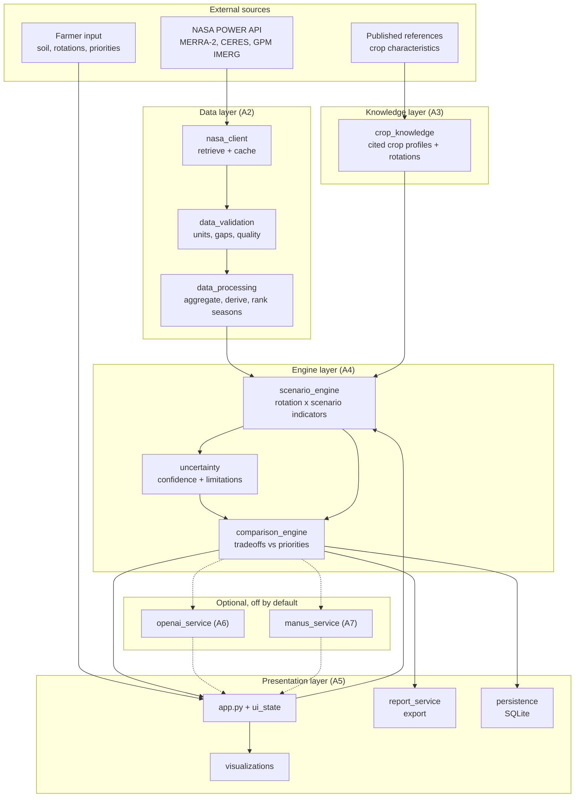

# Architecture

Balanced Architecture (Option A), as established in phase A1.

## Principles

1. **One process, plain Python.** A single Streamlit app with a package of
   small modules. No microservices, containers or message queues.
2. **The science runs alone.** Retrieval, validation, crop knowledge and the
   scenario engine work with every external AI service switched off.
3. **Typed contracts at every boundary.** Modules exchange the Pydantic models
   in `src/models.py`, not loose dictionaries.
4. **Deterministic by design.** The same inputs always give the same results.
5. **Provenance travels with the data.** Each value carries its source,
   version, retrieval time and transformations from ingestion to display.
6. **Honest when incomplete.** A module that is not built says so; the app
   never shows placeholder numbers.

## Layers and data flow

In words: NASA data is retrieved, validated and summarised. Crop
characteristics come from a cited knowledge base. The farmer supplies soil,
rotations and priorities. The scenario engine calculates indicators for each
rotation under each historical scenario, the uncertainty module describes how
far to trust them, and the comparison engine sets the rotations side by side.
The interface displays, exports and optionally saves the comparison. The dotted
lines are optional AI services that only ever *read* a finished comparison.

`config` and `models` sit beneath every layer and depend on nothing else in
the project.

## Module responsibilities

| Module | Phase | Responsibility | Depends on |
| --- | --- | --- | --- |
| `config` | A1 ✅ | Typed settings from the environment; safe defaults; secrets never exposed | — |
| `models` | A1 ✅ | Scientific data contracts and the variable registry | — |
| `nasa_client` | A2 | Retrieve NASA POWER data; cache raw responses; honour offline mode | config, models |
| `data_validation` | A2 | Convert raw responses to observations; explicit gaps; quality flags | models |
| `data_processing` | A2 | Seasonal summaries, derived variables, ranking of past seasons | models |
| `crop_knowledge` | A3 | Cited crop profiles and candidate rotations per pilot region | models |
| `scenario_engine` | A4 | Deterministic indicators for one rotation under one scenario | models |
| `uncertainty` | A4 | Confidence, assumptions and limitations for each result | models |
| `comparison_engine` | A4 | Assemble results, tradeoffs and per-rotation explanations | models |
| `visualizations` | A5 | Accessible Plotly charts built from contract objects | models |
| `ui_state` | A5 | Typed access to Streamlit session state | models |
| `persistence` | A5 | Save and reload comparisons in SQLite | config, models |
| `report_service` | A5 | Export a comparison summary | models |
| `openai_service` | A6 | Optional plain-language restatement of a finished comparison | config, models |
| `manus_service` | A7 | Optional asynchronous background research report | config, models |

Dependencies point one way: a module may import `config`, `models` and modules
listed before it in this table, never one listed after it. The engine never
imports Streamlit, OpenAI or Manus code.

## Data contracts

Defined in `src/models.py`. All are immutable and reject unknown fields.

| # | Contract | Purpose |
| --- | --- | --- |
| 1 | `GeoLocation` | A WGS 84 point |
| 2 | `DataSourceMetadata` | Describes a source: coverage, resolution, latency, licence, citation |
| 3 | `EnvironmentalObservation`, `ObservationSeries` | A past environmental value; a homogeneous time series |
| 4 | `SoilInformation` | Soil properties for a place and depth interval |
| 5 | `CropProfile` | Cited characteristics of one crop |
| 6 | `CropRotation`, `RotationStep` | An ordered, repeating crop sequence |
| 7 | `HistoricalScenario` | A real past period classed as dry, typical or wet |
| 8 | `FarmerPriority`, `FarmerPriorityProfile` | What matters to the farmer, with weights and constraints |
| 9 | `ScenarioResult` | Modelled indicators for one rotation under one scenario |
| 10 | `ComparisonResult`, `RotationAssessment` | The side-by-side comparison and the explanation for each rotation |
| 11 | `UncertaintyStatement` | Confidence, its basis, assumptions and limitations |
| 12 | `ProvenanceRecord` | Where a value came from and what was done to it |

Shared by 3, 4, 5 and 9: `ScientificValue`, one number or one explicit gap with
its unit, quality flag and provenance.

### What the contracts enforce

| Rule | Where |
| --- | --- |
| A variable has exactly one unit; a wrong unit is rejected | Variable registry, `ScientificValue` |
| Physically impossible values are rejected | Variable registry limits |
| A gap is `None` plus a reason; -999, NaN and infinity are rejected | `ScientificValue`, `MissingStatus` |
| Satellite, reanalysis and map values need a retrieval time and a citation | `ProvenanceRecord` |
| Assumptions must be stated; calculations must be described | `ProvenanceRecord` |
| A series cannot mix variables, resolutions, sources, locations or time standards | `ObservationSeries` |
| Observations and scenarios cannot lie in the future | `EnvironmentalObservation`, `HistoricalScenario` |
| A scenario can never be marked as a forecast | `HistoricalScenario.is_forecast` |
| An indicator can never be labelled as observed | `ScenarioResult` |
| Every result needs an uncertainty statement with at least one limitation | `ScenarioResult`, `UncertaintyStatement` |

## Configuration

`src/config.py` loads settings once from environment variables or a local
`.env` file, validates them and freezes them.

| Setting | Default | Meaning |
| --- | --- | --- |
| `OFFLINE_DEMO_MODE` | `false` | Use bundled or cached data only; no network |
| `ENABLE_OPENAI` | `false` | Allow optional OpenAI explanations |
| `ENABLE_MANUS` | `false` | Allow optional Manus reports |
| `NASA_REQUEST_TIMEOUT` | `30` | Seconds; greater than 0, at most 300 |
| `NASA_CACHE_DIRECTORY` | `data/cache` | Where raw NASA responses are cached |
| `DATABASE_PATH` | `data/cropshift.db` | SQLite file for saved comparisons |
| `LOG_LEVEL` | `INFO` | Python logging level |
| `OPENAI_API_KEY` | empty | Future credential (A6) |
| `MANUS_API_KEY` | empty | Future credential (A7) |

An AI service is active only when its switch is on **and** its key is present.
Keys are stored as secret values that do not appear in logs, error messages or
the interface.

## Offline demonstration mode

Planned for A2 and A5. With `OFFLINE_DEMO_MODE=true`, `nasa_client` reads only
from bundled demo files and the local cache, and the interface states that it
is showing stored data along with its retrieval date. The demo files will be
real NASA responses saved during the hackathon, never synthetic data.

## Failure behaviour

| Situation | Behaviour |
| --- | --- |
| Invalid configuration | The app stops with a message naming the setting, without echoing its value (built) |
| NASA API unreachable | Fall back to cache if available; otherwise explain and offer offline mode (A2) |
| Data gap | Shown as a gap with a reason; lowers the stated confidence (A2, A4) |
| Crop parameter with no source | Reported as an information gap; the affected indicator is not calculated (A3, A4) |
| AI service disabled or failing | The comparison is unaffected; the optional panel says it is unavailable (A6, A7) |

## Seams for later automation

Architecture A contains no n8n or Zapier. Three choices keep a later move to
automated workflows (stages M1 to M9) cheap:

1. **Pure functions over contracts.** The planned entry points
   (`fetch_daily_point`, `run_scenario`, `compare`, `build_summary`) take and
   return contract objects and do not touch Streamlit.
2. **JSON at every seam.** Every contract serialises to JSON and back without
   loss (tested), so a workflow tool can pass the same payloads over HTTP.
3. **Side effects at the edges.** Network access lives only in `nasa_client`
   and the two optional services; storage only in `persistence`. A scheduler
   or workflow engine can replace those edges without changing the engine.

## Decisions recorded in A1

| Decision | Reason |
| --- | --- |
| Treat the working folder as the repository root rather than nesting a second `cropshift/` folder | The folder is already named CropShift |
| `pydantic-settings` for configuration | Typed, validated environment loading with secret handling, in a few lines |
| A variable registry with one canonical unit per variable | Makes unit mixing impossible by construction |
| `ScientificValue` shared by observations, soil, crop and indicator values | One place enforces units, gaps and provenance |
| Added `ObservationSeries` | A series, not a single value, is what must not mix resolutions |
| Added `RotationAssessment` | Mirrors the five things the challenge asks to explain per strategy |
| Added `tests/test_imports.py`, `tests/test_app.py`, `tests/conftest.py`, `pytest.ini`, `.streamlit/config.toml`, `docs/mvp_specification.md` | Needed for import and start-up tests, telemetry-free start-up, and a home for the MVP specification |
| Python 3.12 virtual environment | The machine's default Python is 3.15, newer than most packages target; 3.12 satisfies the 3.11+ requirement |
| OpenAI library not installed | Not needed until A6; keeps the core free of it (tested) |
