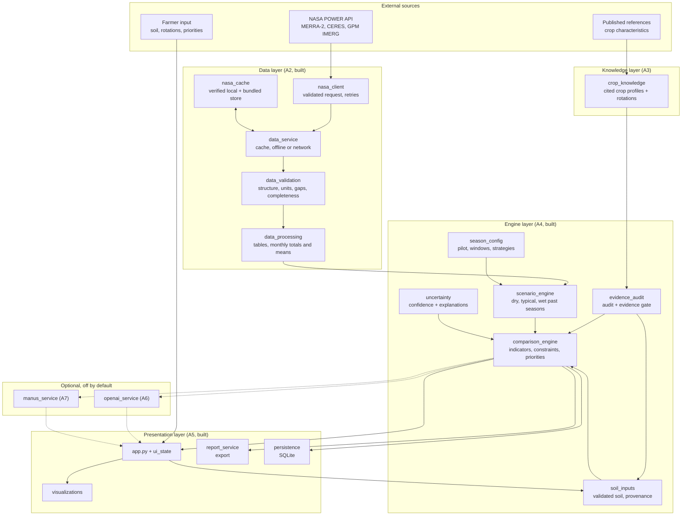

# Architecture

Balanced Architecture (Option A), as established in phase A1.

## Principles

1. **One process, plain Python.** A single Streamlit app with a package of
   small modules. No microservices, containers or message queues.
2. **The science runs alone.** Retrieval, validation, crop knowledge and the
   scenario engine work with every external AI service switched off.
3. **Typed contracts at every boundary.** Modules exchange the Pydantic models
   in `src/models.py`, not loose dictionaries.
4. **Deterministic by design.** The same inputs always give the same results.
5. **Provenance travels with the data.** Each value carries its source,
   version, retrieval time and transformations from ingestion to display.
6. **Honest when incomplete.** A module that is not built says so; the app
   never shows placeholder numbers.

## Layers and data flow



In words: NASA data is retrieved, validated and summarised. Crop
characteristics come from a cited knowledge base. The farmer supplies soil,
rotations and priorities. The scenario engine calculates indicators for each
rotation under each historical scenario, the uncertainty module describes how
far to trust them, and the comparison engine sets the rotations side by side.
The interface displays, exports and optionally saves the comparison. The dotted
lines are optional AI services that only ever *read* a finished comparison.

`config` and `models` sit beneath every layer and depend on nothing else in
the project.

### The data layer in detail (built in A2)

```
PowerRequest ──> data_service.load_dataset
                     │
                     ├─ offline mode?  cache (even expired) ─> bundled data ─> clear failure
                     │                 (no network client is ever created)
                     │
                     └─ online:  fresh cache entry?  ── yes ──────────────────────┐
                                     │ no                                         │
                                     v                                            │
                              nasa_client.fetch                                   │
                              https, timeout, bounded retries with backoff        │
                                     │                                            │
                                     ├─ unreachable ─> expired cache ─> bundled   │
                                     │                 (with a visible warning)   │
                                     v                                            │
                              structure check ─> nasa_cache.put (atomic)          │
                                     │                                            │
                                     v                                            v
                              data_validation.build_dataset  <────────────────────┘
                                 level 1  structure        (fatal if wrong)
                                 level 2  units and values (gaps explicit, impossible discarded,
                                                            unusual flagged)
                                 level 3  completeness     (accepted or not)
                                     │
                                     v
                              EnvironmentalDataset
                                 series      typed observations, one series per variable
                                 quality     QualityReport
                                 provenance  DatasetProvenance
                                     │
                                     v
                              data_processing  ─> daily tables, monthly totals and means
```

The original NASA response is never modified. It is stored whole in the cache
with a SHA-256 fingerprint, and the fingerprint is re-checked on every read and
carried into the dataset's provenance. The full user guide is
[`data_layer.md`](data_layer.md).

## Module responsibilities

| Module | Phase | Responsibility | Depends on |
| --- | --- | --- | --- |
| `config` | A1 ✅ | Typed settings from the environment; safe defaults; secrets never exposed | — |
| `models` | A1 ✅ | Scientific data contracts and the variable registry | — |
| `nasa_client` | A2 ✅ | Validated requests to the NASA POWER Daily API; HTTPS, timeouts, bounded retries; strict response decoding | config, models |
| `nasa_cache` | A2 ✅ | One verified file per request; atomic writes; corruption detection; expiry; also reads bundled demo data | models, nasa_client |
| `pilot_sites` | A2 ✅ | The documented pilot location and historical period | models, nasa_client |
| `data_validation` | A2 ✅ | Three-level validation; typed observations; quality report; dataset provenance | models, nasa_client |
| `data_processing` | A2 ✅ | Daily tables; monthly totals and means; descriptive summaries | models, data_validation |
| `data_service` | A2 ✅ | The data layer's single entry point: cache, offline mode and network; command line | all of the above |
| `crop_knowledge` | A3 ✅ | Evidence registry, cited crop profiles, soil reference values, rotation relationships, constraints, priority definitions, variable mappings; loads and validates `data/knowledge/` | config, models |
| `evidence_audit` | A4 ✅ | The audit record of every source and claim; the evidence gate every calculation passes | models, crop_knowledge |
| `soil_inputs` | A4 ✅ | Validated soil inputs with provenance; FAO-56 Eq. 82 and 83; soil pH comparison | models, evidence_audit |
| `season_config` | A4 ✅ | Provisional pilot configuration, cited season windows, rotation strategies | models, crop_knowledge, pilot_sites |
| `scenario_engine` | A4 ✅ | Season summaries of the NASA record and dry, typical and wet classes | models, data_processing, data_validation, season_config |
| `uncertainty` | A4 ✅ | Confidence rule, uncertainty categories, six-part explanations, unsupported outcomes | models |
| `comparison_engine` | A4 ✅ | Indicators, constraint findings, tradeoffs and priority views; `run_pilot_comparison` | all of the above |
| `visualizations` | A5 ✅ | Accessible Plotly charts built from engine results; no new calculation | comparison_engine, scenario_engine |
| `ui_state` | A5 ✅ | Widget values to typed engine inputs; soil form validation; no Streamlit import | comparison_engine, soil_inputs |
| `persistence` | A5, deferred | Not built: the A5 brief says not to store user inputs without an explicit need | — |
| `report_service` | A5 ✅ | Markdown summary, full JSON and A1 `ComparisonResult` JSON for download | comparison_engine |
| `openai_service` | A6 | Optional plain-language restatement of a finished comparison | config, models |
| `manus_service` | A7 | Optional asynchronous background research report | config, models |

Dependencies point one way: a module may import `config`, `models` and modules
listed before it in this table, never one listed after it. The engine never
imports Streamlit, OpenAI or Manus code.

### The knowledge layer in detail (built in A3)

```
data/knowledge/*.json  ──>  crop_knowledge.load_knowledge_base
   manifest                     │
   evidence_registry            ├─ schema version check
   crops                        ├─ every evidence link resolved against the registry
   soil_reference               ├─ each record validated (units, ranges, required parts)
   rotation_relationships       ├─ cross-checks: families, crop and relationship references,
   farmer_priorities            │   nitrogen-fixing needs a cited statement,
   variable_mappings            │   "directly supported" needs a source that was read,
                                │   a hard constraint needs direct evidence
                                v
                          KnowledgeBase (immutable, fixed order)
                             crops, families, growth-stage examples
                             soil texture references
                             relationships, constraints, documented cropping systems
                             priorities, variable mappings
                             claims() / confidence_summary() / unknowns()
```

The knowledge base is plain JSON under version control, read from local files
only. No network, LLM or external service is involved in loading it. It stores
facts and their evidence; it does not compare, rank or recommend. The user
guide is [`agronomic_knowledge.md`](agronomic_knowledge.md) and the sources are
in [`evidence_registry.md`](evidence_registry.md).

## Data contracts

Defined in `src/models.py`. All are immutable and reject unknown fields.

| # | Contract | Purpose |
| --- | --- | --- |
| 1 | `GeoLocation` | A WGS 84 point |
| 2 | `DataSourceMetadata` | Describes a source: coverage, resolution, latency, licence, citation |
| 3 | `EnvironmentalObservation`, `ObservationSeries` | A past environmental value; a homogeneous time series |
| 4 | `SoilInformation` | Soil properties for a place and depth interval |
| 5 | `CropProfile` | Cited characteristics of one crop |
| 6 | `CropRotation`, `RotationStep` | An ordered, repeating crop sequence |
| 7 | `HistoricalScenario` | A real past period classed as dry, typical or wet |
| 8 | `FarmerPriority`, `FarmerPriorityProfile` | What matters to the farmer, with weights and constraints |
| 9 | `ScenarioResult` | Modelled indicators for one rotation under one scenario |
| 10 | `ComparisonResult`, `RotationAssessment` | The side-by-side comparison and the explanation for each rotation |
| 11 | `UncertaintyStatement` | Confidence, its basis, assumptions and limitations |
| 12 | `ProvenanceRecord`, `DatasetProvenance` | Where a value came from and what was done to it; the full record of one retrieval |

Shared by 3, 4, 5 and 9: `ScientificValue`, one number or one explicit gap with
its unit, quality flag and provenance.

Added in A2, defined next to the code that produces them:

| Type | Module | Purpose |
| --- | --- | --- |
| `PowerRequest` | `nasa_client` | A validated, normalised request; yields the query string and the cache key |
| `PowerRetrieval` | `nasa_client` | An original response with its URL, retrieval time, fingerprint and origin |
| `PowerParameter` | `nasa_client` | Maps a NASA parameter to a CropShift variable, unit, kind of evidence and grid |
| `EnvironmentalDataset` | `data_validation` | Observations, quality report and provenance for one place and period |
| `QualityReport`, `VariableQuality`, `ValidationIssue` | `data_validation` | Completeness per variable, warnings and errors, accepted or not |
| `PilotSite` | `pilot_sites` | A location, period and the reasons for choosing them |
| `DataOrigin` | `models` | Whether data came from the network, the cache or the bundled store |

One registry variable was added: `precipitation_total` (mm), so that a monthly
rainfall total cannot share a name or unit with a daily rate (mm/day).

Added in A3:

| Type | Module | Purpose |
| --- | --- | --- |
| `EvidenceConfidence` | `models` | Directly supported, context-dependent, provisional, insufficient evidence |
| `CropRequirement`, `RequirementBasis` | `models` | One sourced range or value, and whether it is optimal, suitable, tolerated, stage-specific or typical |
| `QualitativeAttribute`, `UnknownAttribute`, `Explanation` | `models` | Sourced statements; explicit gaps; five-part plain-language explanations |
| `SoilEvidenceCategory`, `SoilDrainageClass` | `models` | Measured, mapped, user-entered, assumed, reference or derived soil information |
| `EvidenceSource` | `crop_knowledge` | One source, how it was checked and its limits |
| `BotanicalFamily`, `GrowthStageExample`, `SoilTextureReference` | `crop_knowledge` | Families, published stage lengths, soil-water reference values |
| `RotationRelationship`, `RotationConstraint` | `crop_knowledge` | Sourced relationships and the constraints stored for A4 |
| `DocumentedCroppingSystem`, `CroppingArrangement` | `crop_knowledge` | Systems a cited study actually grew: continuous, rotation or intercrop, with what the source does not report |
| `PriorityDefinition`, `VariableMapping` | `crop_knowledge` | What each priority needs; which input each crop characteristic is compared with |
| `KnowledgeBase`, `KnowledgeManifest` | `crop_knowledge` | The loaded, cross-checked whole and its version |

`CropProfile`, `SoilInformation` and `ProvenanceRecord` were extended with
optional fields, so every earlier use still works. The provisional crop
variables from A1 were replaced by twelve final ones, each a quantity the
sources actually report.

### What the contracts enforce

| Rule | Where |
| --- | --- |
| A variable has exactly one unit; a wrong unit is rejected | Variable registry, `ScientificValue` |
| Physically impossible values are rejected | Variable registry limits |
| A gap is `None` plus a reason; -999, NaN and infinity are rejected | `ScientificValue`, `MissingStatus` |
| Satellite, reanalysis and map values need a retrieval time and a citation | `ProvenanceRecord` |
| Assumptions must be stated; calculations must be described | `ProvenanceRecord` |
| A series cannot mix variables, resolutions, sources, locations or time standards | `ObservationSeries` |
| Observations and scenarios cannot lie in the future | `EnvironmentalObservation`, `HistoricalScenario` |
| A scenario can never be marked as a forecast | `HistoricalScenario.is_forecast` |
| An indicator can never be labelled as observed | `ScenarioResult` |
| Every result needs an uncertainty statement with at least one limitation | `ScenarioResult`, `UncertaintyStatement` |

## Configuration

`src/config.py` loads settings once from environment variables or a local
`.env` file, validates them and freezes them.

| Setting | Default | Meaning |
| --- | --- | --- |
| `OFFLINE_DEMO_MODE` | `false` | Use bundled or cached data only; no network |
| `ENABLE_OPENAI` | `false` | Allow optional OpenAI explanations |
| `ENABLE_MANUS` | `false` | Allow optional Manus reports |
| `NASA_REQUEST_TIMEOUT` | `30` | Seconds; greater than 0, at most 300 |
| `NASA_CACHE_DIRECTORY` | `data/cache` | Where raw NASA responses are cached |
| `NASA_POWER_BASE_URL` | NASA POWER daily point endpoint | Must be plain `https`, with no credentials or query string |
| `NASA_MAX_RETRIES` | `3` | Extra attempts after a rate limit, timeout or temporary server error; 0 to 6 |
| `NASA_CACHE_TTL_HOURS` | `720` | Cache lifetime (30 days) |
| `NASA_DEMO_DIRECTORY` | `data/demo` | Bundled real NASA responses for offline use |
| `NASA_MIN_COMPLETENESS_PERCENT` | `90` | A dataset is accepted only if every variable is at least this complete |
| `DATABASE_PATH` | `data/cropshift.db` | SQLite file for saved comparisons |
| `LOG_LEVEL` | `INFO` | Python logging level |
| `OPENAI_API_KEY` | empty | Future credential (A6) |
| `MANUS_API_KEY` | empty | Future credential (A7) |

An AI service is active only when its switch is on **and** its key is present.
Keys are stored as secret values that do not appear in logs, error messages or
the interface.

## Offline demonstration mode

Built in A2. With `OFFLINE_DEMO_MODE=true`, `data_service` reads the local
cache and then the bundled data in `data/demo/`, and never creates a network
client. The interface states that it is showing stored data, where it came
from and when NASA supplied it. A request that matches nothing stored fails
with a clear message. The bundled file is a real NASA response saved during
the hackathon, never synthetic data, and its fingerprint is checked on every
read.

## Failure behaviour

| Situation | Behaviour |
| --- | --- |
| Invalid configuration | The app stops with a message naming the setting, without echoing its value (built) |
| NASA API unreachable | After bounded retries, fall back to an expired cache entry, then to bundled data, with a visible warning; otherwise report the failure (built) |
| NASA rejects the request | Report NASA's own message; never substitute stored data (built) |
| Malformed or structurally wrong response | Rejected as a whole with a clear error; not cached, not repaired (built) |
| Unexpected unit | Ingestion stops; nothing is converted by guesswork (built) |
| Damaged cache entry | Ignored, reported, and replaced by a fresh request (built) |
| Dataset too incomplete | Returned marked "not accepted" so the reason can be shown; refused for analysis (built) |
| Data gap | Shown as a gap with a reason (built); lowers the stated confidence (A4) |
| Crop parameter with no source | Reported as an information gap; the affected indicator is not calculated (A3, A4) |
| AI service disabled or failing | The comparison is unaffected; the optional panel says it is unavailable (A6, A7) |

## Seams for later automation

Architecture A contains no n8n or Zapier. Three choices keep a later move to
automated workflows (stages M1 to M9) cheap:

1. **Functions over contracts.** The entry points (`data_service.load_dataset`,
   built; `run_scenario`, `compare`, `build_summary`, planned) take and return
   contract objects and do not touch Streamlit. A test confirms that importing
   the data layer loads neither Streamlit nor any AI library. If a workflow
   tool such as n8n is introduced later, `load_dataset` and the command line
   remain a complete, direct route to NASA data.
2. **JSON at every seam.** Every contract serialises to JSON and back without
   loss (tested), so a workflow tool can pass the same payloads over HTTP.
3. **Side effects at the edges.** Network access lives only in `nasa_client`
   and the two optional services; storage only in `persistence`. A scheduler
   or workflow engine can replace those edges without changing the engine.

## Decisions recorded in A1

| Decision | Reason |
| --- | --- |
| Treat the working folder as the repository root rather than nesting a second `cropshift/` folder | The folder is already named CropShift |
| `pydantic-settings` for configuration | Typed, validated environment loading with secret handling, in a few lines |
| A variable registry with one canonical unit per variable | Makes unit mixing impossible by construction |
| `ScientificValue` shared by observations, soil, crop and indicator values | One place enforces units, gaps and provenance |
| Added `ObservationSeries` | A series, not a single value, is what must not mix resolutions |
| Added `RotationAssessment` | Mirrors the five things the challenge asks to explain per strategy |
| Added `tests/test_imports.py`, `tests/test_app.py`, `tests/conftest.py`, `pytest.ini`, `.streamlit/config.toml`, `docs/mvp_specification.md` | Needed for import and start-up tests, telemetry-free start-up, and a home for the MVP specification |
| Python 3.12 virtual environment | The machine's default Python is 3.15, newer than most packages target; 3.12 satisfies the 3.11+ requirement |
| OpenAI library not installed | Not needed until A6; keeps the core free of it (tested) |

## Decisions recorded in A5

| Decision | Reason |
| --- | --- |
| One page with six tabs, controls in the sidebar | Simplest reliable navigation; every tab is testable with Streamlit's test runner |
| Every number from the A2 dataset or the A4 report | The interface must add no science; `app.py` arranges and labels only |
| Chart, state and export logic in modules without Streamlit | Testable on their own; the engine stays independent of the interface |
| Immutable inputs cached once; the report cached by soil and priority order | Interactions stay fast and never contact NASA; different inputs never share a result |
| Section guard around every tab and the sidebar; `showErrorDetails = "none"` | One failing section cannot take the page down, and no stack trace reaches the public page |
| Enums compared by value where cached objects meet fresh input | Streamlit's hot reload can create fresh enum classes while caches keep old ones |
| SQLite persistence deferred | Not needed for the MVP, and storing user inputs needs an explicit reason |

Details: [`a5_ui_architecture.md`](a5_ui_architecture.md).

## Decisions recorded in A4

| Decision | Reason |
| --- | --- |
| An evidence gate between the knowledge base and every calculation | Unsupported values must not be able to reach a result by any route; one checkpoint is testable |
| Numeric inputs only from claims re-checked in the A4 audit | "Every claim used by A4 has been audited" is then enforced, not promised |
| The audit is a separate file; the A3 registry is unchanged | The A3 record of what was read on 14 Nov stays intact; the 15 Nov re-check is its own record |
| ETCCDI held as a method source, not an agronomic source | It defines weather counts, not crop facts |
| Seasons from fixed cited windows; each crop shown in both windows by default | No source gives sowing dates or which crop went in which season; inventing either would be fabrication |
| Terciles of real seasons; representative seasons are real seasons | Reproducible, equal-sized groups; no composite or synthetic season |
| No overall score, no ranking, no weights | No defensible method exists to weigh unlike indicators; priorities reorder presentation only |
| A lab value entered by a user is recorded as user reported | CropShift has not seen the laboratory report |
| New result models in the engine; export to the A1 `ComparisonResult` | The A1 contracts hold numbers only; A4 results also need status, conditions and explanations |
| `UncertaintyStatement.categories` added as an optional field | Uses the existing model, as the brief asked, without breaking A1 code |

The engine is pure Python with no Streamlit, OpenAI or Manus import. A5 calls
`run_pilot_comparison(...)` or `compare_strategies(...)` and displays the
returned `ComparisonReport`; see `a4_validation_report.md`, section L.

## Decisions recorded in A3

| Decision | Reason |
| --- | --- |
| JSON files validated by Pydantic, not a database | Readable, reviewable in version control, works offline, and needs no infrastructure |
| One evidence registry; claims link to it by identifier | A source is described once, and an unknown reference is caught on load |
| Ranges stored with their kind (optimal, suitable, tolerated, stage-specific, typical) | Sources mean different things by a "requirement"; merging them would mislead |
| Seasonal water use and annual rainfall are separate variables | Evapotranspiration is not rainfall demand, and an annual total is not seasonal supply |
| Unknowns are records, not empty fields | A gap that is written down cannot be silently filled later |
| Confidence in four words, no probabilities | No statistical model exists to justify numbers |
| Inconsistent source rows are kept as printed and flagged | Correcting a source silently would be inventing data |
| Constraints are stored, never executed, in A3 | Executing them is a modelling decision that belongs to A4 |
| The same-family rule is recorded as unsupported | No source read supports it; presenting it as established would be dishonest |
| Soil values from satellite, reanalysis or model output are refused | Soil properties must never be inferred from weather data |
| Six crops, two families | Limited to crops with readable authoritative sources; a larger set would have needed guesswork |
| FAO EcoCrop not used | It was behind a sign-in; no unofficial copy was substituted |
| Documented cropping systems kept apart from `CropRotation` | The source names the crops but not their seasons or cycle length; building a `CropRotation` would require inventing those |

## Decisions recorded in A2

| Decision | Reason |
| --- | --- |
| One source first: NASA POWER with six parameters | The A2 brief asked for one reliable source before any other. GPM IMERG is ready to add but was held back |
| Every request in UTC | One time standard for all variables, and the only one that would also work for IMERG |
| Three new modules: `nasa_cache`, `data_service`, `pilot_sites` | Caching and orchestration are separate jobs from making an HTTP request; keeping them apart keeps each testable and keeps dependencies one-way |
| File cache, not SQLite | One self-contained, human-readable file per request is simpler to verify, to bundle for offline use and to inspect |
| The cache stores NASA's original response, not processed data | The original can always be re-validated; processed data could hide a bug |
| SHA-256 fingerprint of every response | Detects damage or editing, and lets anyone confirm the bundled data is unaltered |
| Offline mode may use expired cache entries | Finalised historical data does not go stale; the age is reported |
| Fallback to stored data only when NASA is unreachable, never when NASA rejects a request | A rejection means the request is wrong; hiding it would mislead |
| An incomplete dataset is returned but marked not accepted | The user needs to see why; `require_accepted()` stops it going further |
| Unknown units stop ingestion | A silent unit change is the most dangerous kind of error |
| Coordinates rounded to four decimals, not snapped to grid cells | The grids differ between products, so snapping could return the wrong cell |
| No custom User-Agent or user identifier | Nothing about the participant or project is sent to NASA |
| Monthly totals need a complete month; means need 80 % | A total over fewer days is biased low; a mean is more tolerant |
| `httpx` | Already the project's HTTP library; its mock transport makes retry behaviour testable without a network |
